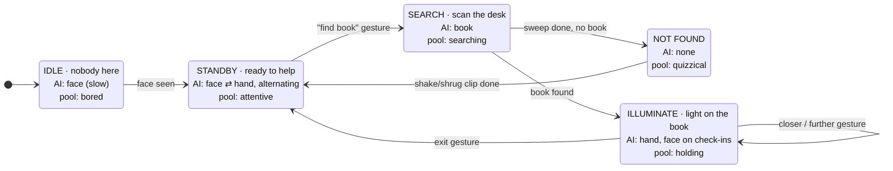
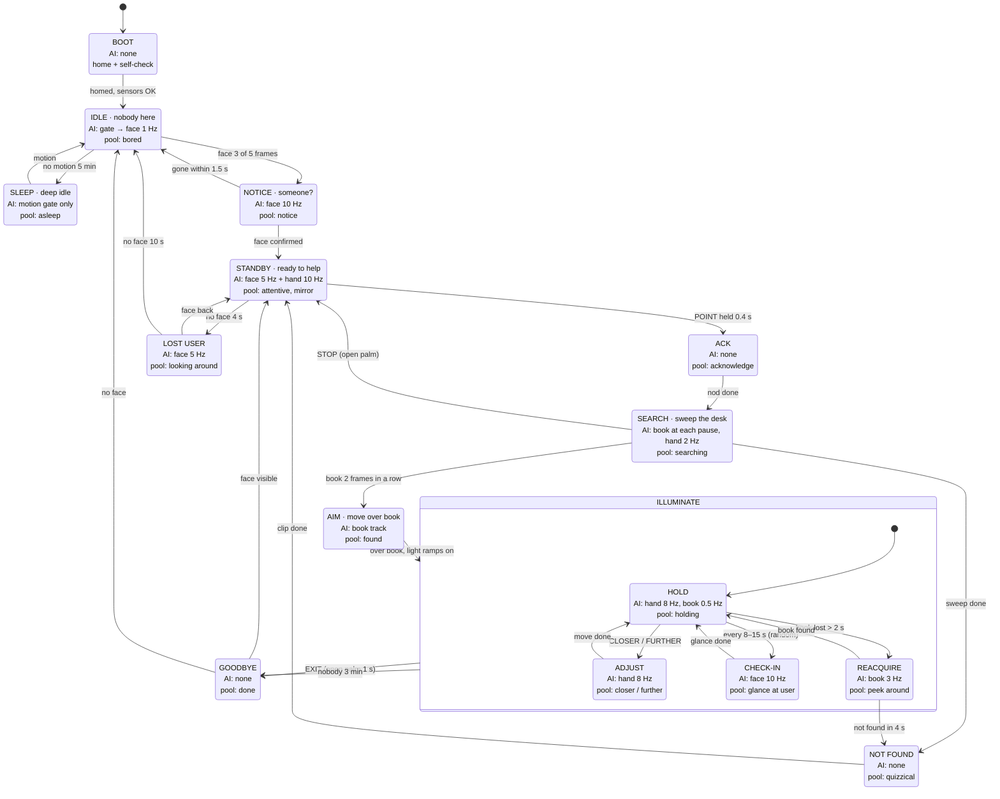
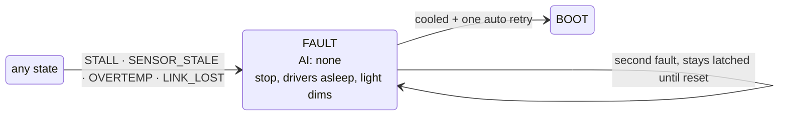

# Lumen behavior state machine

Owner: Victor (software). Status: v0 = the agreed happy path; v1 = the version to build for the demo.

Implemented in [apps/lumen](../apps/lumen/README.md): the tables below live in `apps/lumen/lumen/machine.py` (states, transitions) and `apps/lumen/lumen/behavior/pools.py` (animation pools).

Every state answers three questions:

1. **Which AI models run, and how often.** The models are face, hand gesture and book, plus the free motion gate (a frame difference, no neural net). The state decides the compute budget.
2. **Which animation pool it draws from.** Clip names are from `arm/clips/authored` and `arm/clips/lamp`.
3. **Which event moves it to another state.** Edges are labeled with the event that fires them.

---

## v0: happy path (as specified)



Gaps in v0 that v1 closes:

- No way back to IDLE when the person leaves STANDBY.
- No feedback that a command was understood, so the user can't tell a missed gesture from a slow robot.
- Nothing happens if the book moves or is covered while lit.
- Nothing ends ILLUMINATE if the person walks away without the exit gesture.
- No safe state when a motor stalls or an encoder drops out, and no low-power sleep.
- Two faces in view: no rule for which one to look at.

---

## v1: production



**FAULT is reachable from every state**, so it's drawn separately to keep the main diagram readable:



The STM32 already stops on its own for stale encoders, joint limits and lease expiry. FAULT is the behavior layer catching up: stop sending targets, show it, recover once.

---

## Per-state spec

AI rates are starting points to tune against the power meter. Every rate cut is a scorecard number.

| State | On enter | AI running | Animation pool | Leaves on |
|---|---|---|---|---|
| BOOT | home pose, check encoders + link | none | `home__gentle` | homed → IDLE · check fails → FAULT |
| SLEEP | camera to low fps, CPU clock down, light off | motion gate at 2 fps, no NN | asleep: `go_to_sleep__drowsy` once, then a very slow breathe (`idle_breathe__calm`, amplitude 0.3, time_scale 2) | motion → IDLE |
| IDLE | light off | gate at 10 fps; face at 1 Hz only when the gate fires | bored: `idle_breathe__calm`, `scan_room__calm`, `relaxed_sit_down__calm`, `stretch_reach_limit__short_try`, `tail_wag__small`, `sad_droop__slight` (a sigh), rare `dance_90__groove` | face 3/5 frames → NOTICE · no motion 5 min → SLEEP |
| NOTICE | freeze the current clip and look toward the face | face at 10 Hz | notice: `double_take__subtle`, `perk_up__small`; from SLEEP use `wake_up__slow_groggy` | face confirmed → STANDBY · gone in 1.5 s → IDLE (sheepish `hesitate__subtle`) |
| STANDBY | lock onto the target face | face at 5 Hz + hand at 10 Hz on a crop around the face, interleaved F H H F H H | attentive: procedural look-at on the face, `idle_breathe__alert`, `curious_head_tilt__single`/`__double`, `lean_in_interest__subtle`, `lamp_curious`. Mirror: head follows a waving hand; `tail_wag__small` | POINT held 0.4 s → ACK · no face 4 s → LOST |
| LOST USER | — | face at 5 Hz | `scan_room__alert`, `look_at_user_return__*` | face back → STANDBY · 10 s → IDLE |
| ACK | — | none (it's 0.5 s) | acknowledge: `nod_yes__small_calm`, `nod_yes__medium`, `lamp_yes`, `confident_snap__firm` | clip done → SEARCH |
| SEARCH | plan a sweep of 3–5 pause poses over the desk | book at each pause (1–2 inferences per pose); hand at 2 Hz for STOP | searching: `scan_room__alert`, `point_with_head__left_small`/`__right_big`, `glance_then_reach__left`/`__right`, `approach_object__cautious`, `hesitate__subtle` between poses | book 2 consecutive frames → AIM · sweep done → NOT FOUND · STOP → STANDBY |
| AIM | IK to a pose over the book's center | book tracking (crop) | found: `celebrate__medium` or `excited_bounce__medium` (small), `lamp_happy` | at pose → ILLUMINATE (light ramps up over 0.5 s) |
| NOT FOUND | — | none | quizzical: `shake_no__medium`, `shrug_fail__small`/`__big`, `hesitate__unsure`, then `sad_droop__slight` | clip done → STANDBY |
| ILLUMINATE · HOLD | light on | hand at 8 Hz on the desk crop; book at 0.5 Hz to confirm it's still there | holding: hold the aim pose with micro-noise; `idle_breathe__calm` at amplitude 0.3 | CLOSER/FURTHER → ADJUST · timer → CHECK-IN · book lost 2 s → REACQUIRE |
| · ADJUST | — | hand at 8 Hz | closer: a step along the light axis with `approach_object__eager` flavor; further: `avoid_object__mild` flavor. Small anticipation, then the move. | move done → HOLD |
| · CHECK-IN | dim the light slightly (`LightCoupling` rule) | face at 10 Hz for about 1.5 s | `look_at_user_return__slow_right`/`__quick_left` (`LookBackAtUser` rule) | glance done → HOLD |
| · REACQUIRE | — | book at 3 Hz on a widening crop | `curious_head_tilt__single`, small local sweep | found → HOLD · 4 s → NOT FOUND |
| GOODBYE | light ramps off | none | done: `nod_yes__small_calm`, `home__gentle` | face → STANDBY · none → IDLE |
| FAULT | stop streaming, drivers asleep, light dims | none | `shrug_fail__small` once, only if motion is still allowed; otherwise stay still | cooled + 1 retry → BOOT |

---

## Events (perception → events)

The state machine never sees raw detections. A perception layer turns them into debounced events, which keeps the logic simple and the demo stable.

| Event | Fires when | Notes |
|---|---|---|
| `FACE_SEEN` | face in 3 of the last 5 face frames | |
| `FACE_LOST` | no face for N seconds (4 s in STANDBY, 10 s total) | |
| `MOTION` | gate difference above threshold for 2 frames | |
| `POINT` | index finger extended, others curled, held 0.4 s | the "find book" command |
| `CLOSER` / `FURTHER` | gesture held 0.4 s; repeats every 1 s while held | each repeat is one brightness step |
| `STOP` / `EXIT` | open palm held 1 s | the same gesture means "stop" in SEARCH and "done" in ILLUMINATE |
| `BOOK_FOUND` | book confidence ≥ 0.5 on 2 consecutive inferences | |
| `BOOK_LOST` | no book for 2 s (about 1 check at 0.5 Hz, so add a quick 3 Hz confirm) | |
| `CLIP_DONE`, `MOVE_DONE` | from the motion player | |
| `STALL`, `SENSOR_STALE`, `OVERTEMP`, `LINK_LOST` | from MCU status / gateway | |

### Gesture vocabulary (static poses first)

Static hand poses are far more reliable to classify from the 21 hand landmarks than motions. Ship these for the demo; the moving versions are a stretch.

| Gesture | Means | In states | Moving version (stretch) |
|---|---|---|---|
| ☝️ Point | find the book | STANDBY | point at the desk + glance |
| 👍 Thumbs up | closer / brighter | ILLUMINATE | beckon (fingers curling) |
| 👎 Thumbs down | further / dimmer | ILLUMINATE | push (open palm moving toward lamp) |
| ✋ Open palm, 1 s | stop / exit | SEARCH, ILLUMINATE | wave goodbye |
| 👋 Wave | nothing; it's mirrored for fun | STANDBY | — |

Camera placement matters. The camera rides in the lamp head, so in STANDBY it sees your face and chest: the POINT gesture must happen near your face. In ILLUMINATE it is looking at the book: gestures happen over the book, and your face is out of frame. That's why ILLUMINATE checks in by looking up, and why "no face" alone must never end ILLUMINATE: someone reading has their head down. Only no face, no hand and no motion for 3 minutes ends it.

### Which face

When several faces are visible, pick the largest (closest) one. Switch targets only if another face stays 1.5× larger for 2 s; otherwise the lamp flicks between people.

---

## Cross-cutting layers (apply in every state)

**Noise: no two moves are the same.**
- Each clip plays with random `amplitude` in 0.8–1.2 and `time_scale` in 0.9–1.15, clamped to the clip's validated ranges.
- Holds get a slow random drift on each joint (an Ornstein-Uhlenbeck process, ≤ 1–2°, about 0.3 Hz), so the lamp is never frozen.
- Pool picks are weighted random and never repeat either of the last 2 clips.
- Clamp after noise to the arm's real caps: currently 30 / 25 / 22 °/s shoulder / elbow / head, elbow lift 14 °/s, shoulder ≥ −34°.

**Spunk: a mood variable.**
- `energy` in 0–1 goes up with each interaction (command, gesture, mirrored wave) and decays toward 0.3 over a few minutes.
- High energy biases pools toward the bigger variants (`__big`, `excited_bounce`, `celebrate__big`) and slightly faster time scales. Low energy biases toward `__calm`, `__subtle` and slower ones.
- This is one number, cheap to implement, and it makes the lamp feel like it remembers the last minute.

**Reuse the existing modifier rules** in `tools/motion_lib/modifiers/rules.py` (dev branch). Ported to the 3-joint arm as small plan-building functions in `apps/lumen/lumen/behavior/modifiers.py`; a plan is a list of worker steps (goto / wait / play / mark / rebase) played as one `MotionWorker.seq` command, and every plan goes through `respect_caps()` (min-jerk peaks inside `SPEED_CAPS`, the elbow-lift cap and `ACCEL_CAP`):
- `GlanceBeforeMove` (AIM): the head pitches toward the book first, holds 0.15–0.4 s, then the body follows. On this arm the glance is pitch, not yaw (no yaw joint yet).
- `AnticipationWindup` (AIM, ADJUST): a counter-motion of 10–20 % of the move first, at least 2.5° so it isn't swallowed by the gear backlash.
- `IdleBreathe` (any hold ≥ 2 s): whole `idle_breathe__calm` breaths that fill the hold (used by SLEEP).
- `Hesitation` (uncertain moves: the first REACQUIRE peek): pause, micro-retreat, pause, then commit slower. The NOTICE false alarm uses the `hesitate__subtle` clip instead.
- `LookBackAtUser` is the CHECK-IN plan in the director (it needs the face); `LightCoupling` is the light's job.

---

## Implementation shape

One table drives everything, so a state's AI and pool settings live in one place (and the HUD can print them):

```python
STATES = {
    "IDLE":      dict(models={"gate": 10, "face": 1},  pool="bored"),
    "STANDBY":   dict(models={"face": 5, "hand": 10},  pool="attentive"),
    "SEARCH":    dict(models={"book": "per_pose", "hand": 2}, pool="searching"),
    "HOLD":      dict(models={"hand": 8, "book": 0.5}, pool="holding"),
    # ...
}
TRANSITIONS = {
    ("IDLE", "FACE_SEEN"): "NOTICE",
    ("STANDBY", "POINT"): "ACK",
    ("SEARCH", "BOOK_FOUND"): "AIM",
    # ...
}
```

Loop: perception produces events into a queue → the machine handles one event per tick, runs `exit()` / `enter()` → `enter()` sets the model scheduler's rates and the active pool → the clip player draws from the pool (with the noise and energy layers) and streams targets through `arm_motion` on the board.

Log every transition with a timestamp and the active model set. That log gives you inferences per minute per state for the scorecard, and it's the first thing to read when the demo misbehaves.

Build order for the demo: IDLE ↔ STANDBY with face only → ACK + SEARCH + NOT FOUND with POINT → AIM + ILLUMINATE · HOLD + EXIT → ADJUST → CHECK-IN, REACQUIRE, LOST, SLEEP, FAULT.
