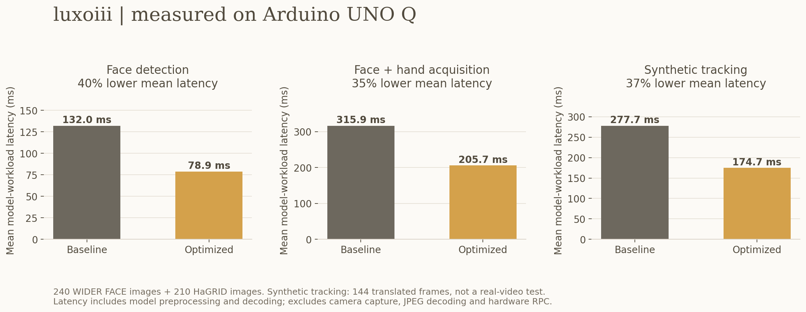

# luxoiii: measured efficiency scorecard

Measured on the team's Arduino UNO Q on October 13, 2026. This addresses
**section 3, AI Optimization & Model Efficiency (20 points)**: a reproducible
baseline, measured optimization, and an explicit accuracy comparison.

The final configuration is live in the observer behind the app on port 8082.
It uses four LiteRT CPU threads per model, sequential scheduling, single-threaded
OpenCV preprocessing, and uint8 face-peak decoding. Model weights, input
resolution and detection thresholds are unchanged. The physical lamp remains
digital On/Off with the same face, beam-angle and expiry checks.

## Before and after

Baseline: commit `7119cf6`, matching the running board code except project naming
comments. Both baseline and candidate use the same existing Qualcomm w8a8 models.
The measured runner executes the same detectors on identical, hash-checked images.

| Workload | Baseline mean | Final mean | Lower latency | p95 before / after |
|---|---:|---:|---:|---:|
| Face detection, 240 images | 132.0 ms | 78.9 ms | 40.3% | 134.5 / 84.6 ms |
| Face + hand acquisition, 210 images | 315.9 ms | 205.7 ms | 34.9% | 338.2 / 226.3 ms |
| Synthetic tracking, 144 frames | 277.7 ms | 174.7 ms | 37.1% | 335.8 / 221.5 ms |

These are **model-workload** times, including preprocessing, inference and
postprocessing. They exclude camera capture, JPEG decoding, network transport
and hardware RPC. The live loop remains capped at 4 observations/second; the
reciprocal benchmark latency is not a claim about camera or end-to-end FPS.

The four-thread default uses the board's available cores to shorten the critical
path. Total CPU work per face + hand acquisition increased slightly, from
583.1 to 602.6 CPU-ms (3.3%). This is a latency optimization, **not a demonstrated
power or energy reduction**. Power was not measured. Active model storage remains
6,477,040 bytes (6.48 MB); the unused canned classifier is excluded from that total.
Evaluation-process peak RSS, including public-image decoding, is
130.11 MiB before and 130.28 MiB after.
This does not establish a memory reduction or measure the complete live app's RSS.

## Accuracy: retained, with important limits

**All 240 face-image and 210 gesture-image predictions are exactly identical**
(boxes, scores and gesture labels) between baseline and final. The final synthetic
sequence also preserves all 144 per-frame hand counts and gesture-label lists.
Its ground-truth audit retains 116/156 hand matches and 98/156 correct gestures.

| Public-data measure | Baseline | Final |
|---|---:|---:|
| Face precision, IoU >= 0.5 | 94.1% (744/791) | 94.1% |
| Face recall, all valid faces | 23.1% (744/3,220) | 23.1% |
| Face recall, both dimensions >= 32 px at model input | 91.7% (333/363) | 91.7% |
| Hand localization recall, IoU >= 0.5 | 67.8% (175/258) | 67.8% |
| Gesture accuracy among localized hands | 71.4% (125/175) | 71.4% |
| End-to-end correct gesture recall, including missed hands | 48.4% (125/258) | 48.4% |

The 32-pixel face number must be accompanied by the much lower all-size recall.
The face model misses many tiny faces in crowd scenes. Pointing achieves 21/60
correct target labels including misses, versus palm 25/30, thumbs-down 22/30,
and thumbs-up 20/30. Negative/no-command cases also need improvement. These are
small public-dataset subsets, not a claim of broad deployment accuracy or a
safety certification. No training or threshold tuning was performed on these data.
Upstream training-data overlap is not independently known.

WIDER FACE metrics here are subset box precision/recall, not official
Easy/Medium/Hard AP. HaGRID boxes are compared with the inferred landmark extent.
A complete confusion table and every prediction are saved in the raw JSON.

## What was tried and why the default was selected

1. **CPU thread sweep:** 1, 2 and 4 threads, 24 timed invocations per model after
   warmup. Four threads improved isolated face, palm and landmark latency.
   Random pixels were used for this latency-only sweep, not accuracy claims.
2. **Concurrent face/hand execution:** two threads per model reduced combined
   still-image latency to 203.9 ms, but face-only latency was 135.2 ms. Four
   sequential threads give comparable combined latency and much faster face-only
   checks, which continue while hands sleep and gate the physical lamp.
3. **Fixed-point peak selection:** face peaks are selected in uint8; a cached
   256-entry sigmoid table preserves exact scores. Only candidate boxes are
   dequantized. Full-frame grayscale inputs avoid a redundant padded canvas.
   A board-side randomized decoder test and the public-image comparison verify
   equivalence. No isolated latency claim is attributed to this change.
4. **More aggressive single-hand ROI reuse:** scanning palms every third frame
   reduced palm invocations from 93 to 50 in the synthetic sequence, but matched
   hands fell from 116 to 111 and correct gestures from 98 to 95. It is therefore
   **disabled by default**. The main app keeps searching for a second hand on
   every frame while only one hand is tracked. Stale crops expire after a gap.

The existing 8-bit quantization came from the supplied models. This work does
not claim new quantization, pruning, distillation, retraining or NPU acceleration.
The synthetic sequence consists of small translations of 12 public images;
it is not a replacement for real two-hand video, motion-blur or crossing-hand tests.

## Reproduction and evidence

- [Runner, metric definitions and download instructions](../../tools/efficiency/README.md)
- [Baseline raw results](baseline-results.json), [final raw results](final-results.json)
- [Paired comparison and bootstrap intervals](comparison.json)
- [Thread sweep](runtime-sweep.json)
- [Live reconnection and lamp-gate check](live-check.json)
- [Concurrent ablation](parallel-2-results.json), [four-thread ROI experiment](serial-4-results.json)
- [Baseline motion audit](temporal-baseline.json), [rejected ROI motion audit](temporal-roi-experiment.json)
- [WIDER selection manifest](wider-manifest.json), [HaGRID selection manifest](hagrid-manifest.json)

The observer was paused during measurements; its automatic lamp lease expired.
The camera service remained running. Both controlled variants used one OpenCV
thread, while the prior live observer used OpenCV's four-thread default. Final timing runs followed complete dataset
staging, with six warmup calls and no separate inference workload running. Runs
were ordered, so thermal/system variance is not eliminated. Bootstrap intervals
resample source images/sequences; they do not measure run-to-run hardware variance.
The machine is a four-core Qualcomm Kryo-V2 ARM64 CPU with LiteRT 2.3.0,
OpenCV 5.0.0 and NumPy 2.3.3; LiteRT reported the CPU XNNPACK delegate.

## Public dataset sources

[WIDER FACE, CUHK](https://huggingface.co/datasets/CUHK-CSE/wider_face): fixed
240-image validation sample, selected without model scores. Yang, Luo, Loy and
Tang, CVPR 2016; CC BY-NC-ND 4.0.

[HaGRIDv2, official project](https://github.com/hukenovs/hagrid): fixed test
sample of 30 images in each of seven categories, one image per subject within
category. Nuzhdin et al., 2024; see the project's variant of CC BY-SA 4.0.
Images remain outside the repository; manifests, predictions and measurements
are committed so the experiment can be repeated without publishing the photos.

## Regression and live checks

The local suite ran 302 tests with four skipped because local hardware/runtime
features are unavailable. The real UNO Q decoder equivalence test passed;
the JavaScript emotion and desk-light checks passed. After deployment, twelve
successive 8082 snapshots were fresh, hands were available, tracking was enabled
and connected, and the steppers remained disabled. The light was correctly off
because the estimated physical beam extended above the horizon.

## Live CPU, RAM and energy audit

We sampled the running UNO Q twice for 60 seconds on October 13, 2026, without
pausing services or changing hardware controls. These are uncontrolled live
workloads, separate from the fixed-image tests above.

The second sample ran from **20:57:17 to 20:58:17 UTC (1:57–1:58 pm Pacific)**.
All 61 observer snapshots were fresh; the observer and web process IDs stayed
unchanged. CPU percentages use the full four-core capacity (one core = 25%).

| Scope | Mean CPU | Sampled peak CPU | Mean RAM | Sampled peak RAM |
|---|---:|---:|---:|---:|
| AI observer | 57.0% | 60.0% | 112.3 MiB | 112.5 MiB |
| Web server | 0.8% | 1.3% | 24.0 MiB | 24.3 MiB |
| LuxoIII combined | 57.9% | 61.0% | 136.3 MiB | 136.5 MiB |
| Whole board | 66.8% | 72.9% | 757.8 MiB | 764.4 MiB |

Process RAM is proportional set size (PSS), which apportions shared pages;
combined app RAM sums the two services' PSS. For comparison, observer mean RSS
was 122.5 MiB and web mean RSS was 33.6 MiB; summing RSS would
double-count shared pages. Whole-board RAM is `MemTotal - MemAvailable`, including
Linux and other services, out of 3669.9 MiB reported by Linux. Browser
rendering on the viewing computer is excluded. Peaks are sampled about once per
second, not guaranteed instantaneous maxima. Sampler overhead is included in
whole-board usage.

We counted **189 face passes and 189 hand-pipeline updates over 60.2 seconds**,
or **3.14 updates/s**. Palm detection also ran 189 times. These counters overlap
and must not be summed into a total neural-inference count. The scene had 0–3
detected faces and **no detected hands**, so this is an active face + palm search
sample, not a two-hand landmark workload. The counter window follows cached
observation timestamps and differs slightly from the resource window.

The first sample (20:55:40–20:56:40 UTC) had **20/61 invalid observer snapshots**
(32.8%). Its valid resource readings averaged **36.0% app CPU and 135.2 MiB app
PSS**, with whole-board CPU 46.2% and RAM 764.5 MiB. We excluded invalid snapshots
from scene statistics after auditing their missing counters and stale ages. The
initial sampler did not retain the API's underlying error, so its cause is not
established. Both runs are retained; different scenes and interruptions mean
this is not a before/after optimization comparison.

**Inferences per joule: not measured.** The board exposed no power-supply devices,
IIO devices, powercap interface, or voltage/current/power/energy readings in its
11 thermal/Wi-Fi hwmon devices. No external measurement was available. CPU usage,
CPU time, latency, and charger ratings cannot establish electrical efficiency.
A future measurement needs a defined completed workload and matched measured
input energy: `workloads/J = completed workloads / measured joules`, equivalent
to matching throughput divided by average watts. State whether camera, servo,
and separately powered lamp consumption is included. We claim no power savings.

- [Second sample with all resource readings and code hashes](live-resources.json)
- [Initial sample, including invalid observation markers](live-resources-initial.json)
- [Read-only sampler](../../tools/efficiency/measure_live_resources.py) and
  [reproduction instructions](../../tools/efficiency/README.md#live-cpu-ram-and-processing-rates)
